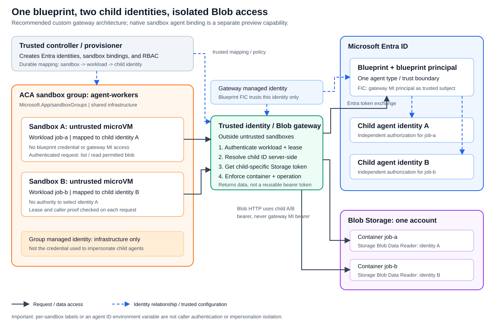
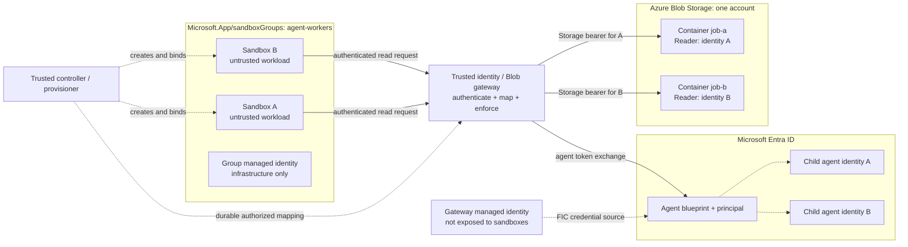

# Agent identities for Azure Container Apps Sandboxes

**Recommendation:** use one Entra agent identity blueprint per agent type and trust boundary, and one child agent identity per independently authorized sandbox workload. Keep the blueprint's authentication capability outside untrusted sandboxes. For Blob Storage, grant each child identity access to its own container and perform reads through a trusted identity/Blob gateway.

This document targets **Azure Container Apps Sandboxes (`Microsoft.App/sandboxGroups`)**, not Azure Container Instances or Dynamic Sessions. It describes an architecture; it does not deploy resources or implement the gateway.

## 1. What maps to what?

| Component | Identity responsibility |
| --- | --- |
| Sandbox group | Regional infrastructure/configuration boundary. Its Azure managed identity, if configured, serves infrastructure purposes such as registries and gateway connections. It is not an Entra agent blueprint. |
| Agent identity blueprint | Entra application defining the agent type and holding credential/trust configuration. Use separate blueprints for production vs. development or other materially different trust domains. |
| Blueprint principal | Entra service principal representing that blueprint in the tenant. Required before creating child agent identities. |
| Sandbox workload A | Associated with child agent identity A; no authority to select B or impersonate other blueprint children. |
| Sandbox workload B | Associated with child agent identity B; independently authorized and retired. |
| Trusted controller/provisioner | Creates identities, sandboxes, and the durable mappings between them. This is the provisioning identity, not an agent runtime identity. |
| Trusted identity/Blob gateway | Authenticates the calling workload, chooses its mapped child identity, gets the child's Storage token, and performs approved Blob operations. This is a component you build or a platform capability you separately verify. |
| Gateway managed identity | Authenticates the blueprint through a federated identity credential (FIC). Do not make this identity available to untrusted sandbox code. |

The blueprint is **associated with the deployment in your controller's configuration**, not assigned to the sandbox group's ARM `identity` field. The latter takes Azure managed identities.

There need not be exactly one blueprint per sandbox group. Several groups can run the same agent type; conversely, different trusted agent types could use different blueprints in one group. For the first example, use one group, one blueprint, and two child identities. Separate groups when infrastructure operators, secrets, or tenant trust boundaries must also be isolated.

**Choose the logical identity lifetime deliberately.** A short-lived job can receive a new identity per job/sandbox. A durable logical agent can retain its identity across a resume or replacement instance. Do not automatically reuse a single identity across unrelated users/tasks, and do not create a new identity for every LLM turn.

## 2. Diagram: two sandboxes, two Blob identities



Solid arrows are requests/data access. Dashed arrows are identity relationships or trusted configuration. The gateway sits **outside both untrusted microVMs**. Although it executes the HTTP requests, the OAuth bearer used for Blob Storage represents child identity A or B, not the gateway's managed identity.



## 3. Native sandbox bindings: what is verified vs. assumed

The public **2026-09-01-preview** sandbox data-plane schema includes:

- `CreateSandboxContent.agentIdentity`, a `SandboxAgentIdentityRef` with `tenantId` and `agentId`.
- `Sandbox.agentIdentity` on the returned sandbox model.
- `identitySettings`, which control which group identities are available to an individual sandbox. The documented lifecycle values include `None`, `Main`, and `All`.

For a deployment/API version that supports these fields, the relevant **creation-body fragment** for A is:

```json
{
  "agentIdentity": {
    "tenantId": "YOUR-TENANT-GUID",
    "agentId": "AGENT-IDENTITY-A-GUID"
  }
}
```

This is not a complete create request. Apply it using the supported sandbox data-plane client/API for the selected preview version, together with that version's normal source/resource settings. Do not send sandbox creation to Microsoft Graph or to a normal Container App create API.

**Important limits of the evidence:**

| Verified capability | What it does not prove |
| --- | --- |
| Schema contains a per-sandbox agent identity reference. | Automatic creation of the Entra blueprint/child, automatic FIC setup, or automatic Blob RBAC grants. |
| Schema contains per-sandbox managed-identity availability settings. | The default exposure policy, the exact runtime token endpoint contract, or child-agent token isolation in your deployed region/version. |
| Group managed identity is documented for infrastructure/gateway use. | Each sandbox receives a separate managed identity or a native token for its assigned child agent. |
| The installed `aca sandbox create --help` exposes creation, connections, and egress settings. | This inspected CLI exposes an agent-identity creation flag; it currently does not. Do not invent `--agent-id` or `--blueprint-id`. |

Treat `agentIdentity` as a supported **reference/binding in the preview schema**, not as proof that adding the field makes `DefaultAzureCredential()` return a child-agent token. Validate acceptance, read-back, identity selection, and token delivery against the actual service before relying on a native path.

Likewise, a sandbox label or an `AGENT_IDENTITY_ID` environment variable is only configuration. It is not proof that the caller owns that identity.

The gateway architecture below does not require an undocumented native token endpoint. A native platform token service can replace the custom token component **only after its binding and authorization guarantees are documented and tested**. Microsoft Foundry's hosted-agent token service is a different product contract; do not assume it is available in arbitrary ACA sandboxes.

## 4. Why not give every sandbox the group's identity?

Suppose all sandboxes can obtain tokens from the same managed identity, and the blueprint trusts that identity. Each sandbox could request a blueprint token with a different `fmi_path` and attempt to impersonate another child of the same blueprint.

**A different agent ID in each sandbox's configuration does not prevent this.** Distinct Blob role assignments do not help if a compromised sandbox can acquire its neighbor's token.

Use this separation:

1. The group identity has only necessary infrastructure permissions. It is not the credential trusted to impersonate the blueprint's child agents.
2. Only the trusted gateway can access the blueprint's credential source.
3. The gateway authenticates the workload and resolves its child identity from trusted controller state.
4. The gateway rejects caller-selected child IDs, arbitrary resource audiences, arbitrary Storage accounts/containers, and unauthorized operations.

Where available, explicitly restrict group identity exposure with the supported `identitySettings` policy and test it. Do not rely on a documented identity field implying a deny-by-default policy. A helper process or localhost sidecar inside the same untrusted microVM is **not** an adequate privilege boundary by itself.

Notebook 03's direct `ManagedIdentityCredential` -> blueprint exchange is suitable for a **trusted host**. Do not copy that notebook's shared blueprint credential source into mutually untrusted sandboxes.

## 5. Provisioning and binding workflow

### One-time setup per agent type/environment

1. Create or reuse the Entra blueprint and its blueprint principal, as in notebook 02.
2. Run a trusted controller and a trusted gateway outside the workload sandboxes. Their provisioning vs. runtime permissions should be distinct.
3. Attach a managed identity to the gateway's Azure host. Configure a blueprint FIC that trusts that MI:
   - issuer: `https://login.microsoftonline.com/TENANT-ID/v2.0`;
   - subject: gateway MI **principal/object ID**, not its client ID;
   - audience: `api://AzureADTokenExchange`.
4. Create/configure the sandbox group, source disks, networking, and explicit egress policy separately. Grant **Container Apps SandboxGroup Data Owner** only to trusted principals that actually need sandbox management. This role is powerful; it is not a workload's Blob role.
5. Give the provisioning automation the required, admin-consented Graph application permissions and narrowly scoped Azure role-assignment authority. The gateway should not need permission to create Graph identities or assign Azure roles.
6. Establish the per-workload authentication mechanism between sandbox and gateway. This is a required implementation step, not supplied by an arbitrary sandbox ID in an HTTP header.

Use the supported blueprint-specific FIC API and required permissions. Notebook 03 calls out preview/version considerations for that setup; verify the API available in your tenant before automating it.

### Per independently authorized workload

1. Allocate a workload/run identifier in a durable controller store.
2. Create child agent identity A beneath the blueprint, with the responsible sponsor. Persist its ID immediately.
3. Choose/create the authorized Blob container and assign A **Storage Blob Data Reader** at that container scope.
4. Create sandbox A with its nonsecret configuration and, where supported, its native `agentIdentity` reference. Persist the returned real sandbox ID.
5. Persist the binding `{tenant, group, sandbox, workload, identity, allowed container, operations, generation, expiry}`. Enable gateway access only after relationship and permission setup is verified.
6. Deliver the workload's scoped authentication/bootstrap material through a trusted channel; validate the actual caller at the gateway.
7. Test a read as A and a denied cross-container request before enabling normal work.

Use the sandbox platform's supported API/SDK surface for binding features and declarative manifests for reproducible sandbox configuration. The **manifest pattern is recommended for CI/CD**, not a series of untracked imperative creates. The controller still handles the dynamic Entra identities, role assignments, and runtime mappings; a YAML label is not an identity grant.

For the base sandbox configuration, the CLI flow is:

```powershell
aca sandbox init | Set-Content -Encoding utf8 sandbox.yaml
# Review/edit the generated configuration before validation and application.
aca sandbox validate --file sandbox.yaml
aca sandbox apply --file sandbox.yaml
```

This illustrates the flow; it has not been executed here. Do not assume the installed manifest schema accepts newer preview identity fields just because the REST schema does. Use a compatible API/SDK for the native binding, and reconcile the actual returned sandbox with the controller's record. Also, `apply` is described by the inspected CLI as creating from a spec: repeated application is not a substitute for your own workload idempotency/reconciliation.

The controller's durable record might look like this (identifiers abbreviated for readability):

```json
{
  "tenantId": "tenant-guid",
  "sandboxGroupResourceId": "/subscriptions/.../providers/Microsoft.App/sandboxGroups/agent-workers",
  "blueprintObjectId": "blueprint-directory-object-guid",
  "blueprintClientId": "blueprint-application-guid",
  "workloadId": "job-a",
  "sandboxId": "actual-returned-sandbox-id",
  "agentIdentityId": "child-a-guid",
  "containerScope": "/subscriptions/.../providers/Microsoft.Storage/storageAccounts/account/blobServices/default/containers/job-a",
  "allowedOperations": ["list", "read"],
  "generation": 1,
  "status": "active",
  "leaseExpiresAt": "controller-issued-expiry"
}
```

Persist this in a suitable durable store, not only in `.env` or a disposable CI runner's filesystem. Provisioning must handle partial success, duplicate/replayed job requests, bounded retries, and orphan cleanup. Notebook 02 keeps IDs in Python variables and prints values to copy into `.env`; that is an educational workflow, not the production state store.

## 6. Runtime authentication and Blob access

For sandbox A:

1. A sends an authenticated request such as `read sample.txt` to the gateway.
2. The gateway verifies the caller's credential/proof, active lease, tenant, sandbox binding, and allowed operation.
3. It resolves **identity A and container job-a from server-side state**, not from a client-selected `agentId` or URL.
4. The gateway MI acquires a credential token for `api://AzureADTokenExchange/.default`.
5. The gateway authenticates the blueprint using that MI assertion with `fmi_path=A`, obtaining intermediate token T1.
6. It exchanges T1 using `client_id=A` and `scope=https://storage.azure.com/.default`.
7. It calls Blob Storage with A's resource token, inside the approved container, and returns the permitted data to A.

Repeat for B with identity B and container job-b.

Prefer approved Entra agent authentication SDKs or the supported Agent ID auth sidecar inside the **trusted gateway boundary** for production. Notebook 03 demonstrates the two-step protocol but its educational adapter is not a production broker.

### Authenticate the sandbox-to-gateway hop

This hop requires real design and validation. Prefer a provider-backed, instance-bound identity/proof where supported, or a trusted ingress/authentication layer that independently binds the caller to a specific workload. A controller-issued, short-lived signed session credential is another possible application mechanism, but it is a bearer credential: theft or snapshot cloning can allow replay until rejected/expired.

Validate audience, issuer, tenant, signature, expiry, generation, and active server-side lease. Do not accept a caller's sandbox ID, labels, IP address, or unverified JWT claims as sole authorization proof. Rate-limit and audit access.

**Fail closed:** if your selected service version cannot establish an adequate instance binding, do not claim hard per-instance isolation. Use a stronger deployment boundary or a trusted proxy that performs the data operation without accepting untrusted identity selection.

### Keep tokens out of the sandbox

For untrusted code, prefer **Blob operations through the gateway**, rather than returning a reusable Storage bearer token. This permits operation/path controls, reduces token exfiltration, and lets the gateway stop future requests as soon as it disables a lease.

If trusted agent code requires a direct Blob SDK credential, a supported broker can return only that agent's short-lived Storage token. That is a different risk profile: the token can be copied, and existing tokens can remain usable until expiry or service-side policy enforcement. Granting or removing RBAC is not an instantaneous kill switch.

Do not put blueprint secrets, MI assertions, T1 tokens, group administration tokens, or broad account SAS credentials into sandbox environment variables, group secrets exposed to workloads, snapshots, or shared volumes.

## 7. Blob permissions: a concrete example

Use one Storage account and two containers:

| Identity | Role | Scope | Expected result |
| --- | --- | --- | --- |
| Child A | Storage Blob Data Reader | Container `job-a` | Can list/download in `job-a`; denied in `job-b`. |
| Child B | Storage Blob Data Reader | Container `job-b` | Can list/download in `job-b`; denied in `job-a`. |
| Group infrastructure MI | No demo Blob data role | None | Not the data-reading agent. |
| Gateway MI | No direct demo Blob data role | None | Authenticates the blueprint, but reads use A/B tokens. |
| Provisioner | Restricted role-assignment authority | Approved storage scopes | Sets up grants; not used for runtime reads. |

The container scope is:

```text
/subscriptions/SUB/resourceGroups/RG/providers/Microsoft.Storage/storageAccounts/ACCOUNT/blobServices/default/containers/CONTAINER
```

An authorized administrator can assign the role as follows:

```powershell
$AgentIdentityObjectId = 'CHILD-AGENT-IDENTITY-GUID'
$ContainerScope = '/subscriptions/SUB/resourceGroups/RG/providers/Microsoft.Storage/storageAccounts/ACCOUNT/blobServices/default/containers/job-a'
az role assignment create `
    --assignee-object-id $AgentIdentityObjectId `
    --assignee-principal-type ServicePrincipal `
    --role 'Storage Blob Data Reader' `
    --scope $ContainerScope
```

For Entra agent identities, Microsoft documents that object ID and app/client ID have the same value. For blueprints, use the `id` and `appId` returned by Graph for their respective purposes; do not assume the values must differ. Managed identities have different object/principal IDs and client IDs.

**A blob-name prefix is not a standard Azure RBAC scope.** Do not claim that `job-a/` and `job-b/` prefixes in one shared container are isolated by a container-level role assignment. Use separate containers, or deliberately implement and test supported Storage ABAC conditions/path authorization for a shared container.

For uploads, deliberately add Storage Blob Data Contributor at the narrow scope needed and add corresponding gateway operations. Keep the initial example read-only.

A group-level AzureBlob volume is a persistence feature, not proof that accesses use each sandbox's child identity. Avoid a broad shared mount when the purpose is per-agent identity authorization; verify the mount's backing identity and visibility separately.

## 8. Lifecycle: creation, suspend, resume, clone, deletion

| Event | Identity/authorization handling |
| --- | --- |
| Create | Allocate child identity and durable mapping; enable the lease after provisioning/read-back succeeds. |
| Run | Enforce lease, identity, container, and operation on each gateway request. Cache tokens by tenant + child identity + audience, never as one global group token. |
| Suspend | Stop accepting new gateway requests for the suspended workload; do not assume its Entra identity disappeared. |
| Resume same logical workload | Retain the child identity if that is the chosen lifecycle; revalidate ownership and refresh the lease/authentication material and expired resource tokens. |
| Clone snapshot for an unrelated workload | Allocate a new child identity and mapping. Do not inherit the original workload's authorization just because its memory/disk was copied. |
| Replace an instance | Transfer authorization deliberately; retire the old instance lease before granting the replacement access, unless concurrent use is explicitly intended. |
| Retire/delete | Disable the gateway lease first, remove recorded RBAC grants, retire/delete the child identity according to retention policy, and delete sandbox artifacts as appropriate. |
| Delete the group | Explicitly reconcile externally created Graph objects and Azure role assignments; do not assume group deletion cleans them up. |

Sandboxes can snapshot **memory and disk**. Clearing a token from a file while leaving it in a process does not create a credential-free snapshot. Prefer sanitized baseline images/snapshots for cloning and keep powerful credentials outside the microVM. Snapshot useful non-sensitive state before destructive sandbox deletion, but do not turn that snapshot into a reusable authorization credential.

Controller reconciliation should detect orphan sandboxes, orphan child identities, stale leases, incomplete role assignments, and mappings whose tenant/blueprint relationship changed. Use bounded retries for propagation; role changes can take minutes to become effective.

## 9. Network and audit controls

For production sandbox code, use **deny-default egress** with an explicit allow-list. In the gateway-mediated design, permit the gateway and only the other endpoints the workload actually needs, not general access to token services or arbitrary Storage accounts.

The supported CLI shape for such a policy is:

```powershell
aca sandbox egress set --id $SandboxId `
    --default Deny `
    --rule 'blob-gateway.example.com:Allow' `
    --traffic-inspection Full
```

This is a policy-shape example, not a deployed gateway address. Verify TLS-inspection compatibility with your chosen authentication protocol and certificate policy. The gateway separately needs network access to Entra token endpoints and the approved Blob account; configure private endpoints/DNS and network restrictions as required.

Log correlation identifiers, not secrets:

```text
tenant, group, sandbox, workload, generation, child-agent-id,
operation, approved-container, decision, Entra-correlation-id, Storage-request-id
```

Use these to correlate gateway decisions, Entra sign-ins, and Storage resource logs. Access performed using A's bearer should show A as the resource identity; the managed identity authenticates the blueprint in the preceding exchange. Never log bearer tokens, client assertions, blueprint credentials, or sensitive Blob contents.

## 10. Acceptance checks before trusting the design

| Check | Required outcome |
| --- | --- |
| Preview native binding | Create/read back A's `agentIdentity` on the actual service version; confirm unsupported versions fail rather than silently dropping it. |
| Relationship | A and B are children of the intended blueprint in the correct tenant. |
| Workload proof | Spoofed labels/IDs or unsigned/expired session claims cannot authenticate to the gateway. |
| Cross-identity | A cannot ask the gateway to act as B or choose a different `fmi_path`. |
| Credential exposure | A/B cannot access the gateway MI, blueprint credential, T1, or administrative credentials. Test all identity endpoints actually exposed by the deployment. |
| Resource isolation | A reads `job-a` and receives a denial for `job-b`, including through any direct network path; vice versa for B. |
| Operation isolation | Read-only access cannot upload/delete; gateway does not accept arbitrary URLs or path escapes. |
| Token attribution | Storage and Entra evidence agree on the intended child identity; unverified JWT decoding alone is not evidence of server-side authorization. |
| Suspend/retire | Subsequent gateway requests fail when the lease is inactive. |
| Snapshot clone | Replayed original-workload credentials do not authorize a new workload. If the platform/auth mechanism cannot guarantee this, document the residual replay risk and change the boundary. |
| Partial provisioning | Retries reuse successful objects; cleanup does not delete another workload's identity or grants. |
| API/CLI compatibility | Preview binding and identity-setting semantics are tested; no unsupported CLI flags are required. |

These are proposed integration checks, **not tests already executed against Azure**.

## 11. Relationship to the existing notebooks

- [Notebook 02](../02_provision_agent_identity.ipynb) teaches blueprint/principal/child provisioning. Replace its in-memory IDs/manual `.env` handoff with a controller-owned, durable per-workload registry for production.
- [Notebook 03a](../03a_agent_identity_client_secret.ipynb) teaches local blueprint-secret authentication; [notebook 03b](../03b_agent_identity_managed_identity.ipynb) teaches Azure managed-identity federation. Both combine delegated Graph access with app-only Blob authorization. Keep their blueprint-authentication logic in the trusted gateway for untrusted sandbox workloads.
- Model access and Blob tool access remain separate permissions. None of this automatically publishes a Foundry agent or registers it in Agent 365.

## Sources and capability status

Sandbox preview APIs, SDKs, and CLI coverage evolve. The native binding shapes above were checked in the public REST specification at revision `6ad5af824ebf340b4a83889dbdd70572124b57a5`; they are not a claim that the whole design is a turnkey service feature.

1. [ACA Sandboxes overview: groups, data plane, lifecycle, roles](https://learn.microsoft.com/azure/container-apps/sandboxes-overview)
2. [Sandbox group Bicep guide: infrastructure managed identities](https://learn.microsoft.com/azure/container-apps/sandboxes-quickstart-bicep)
3. [Public sandbox data-plane models: `CreateSandboxContent`, `SandboxAgentIdentityRef`, `IdentitySetting`](https://github.com/Azure/azure-rest-api-specs/blob/6ad5af824ebf340b4a83889dbdd70572124b57a5/specification/app/data-plane/ContainerApps/models/sandboxes.tsp)
4. [Public create example, 2026-09-01-preview](https://github.com/Azure/azure-rest-api-specs/blob/6ad5af824ebf340b4a83889dbdd70572124b57a5/specification/app/data-plane/ContainerApps/examples/2026-09-01-preview/AzureSandboxes_Create.json)
5. [Entra autonomous agent OAuth flow: blueprint impersonation and token exchange](https://learn.microsoft.com/entra/agent-id/agent-autonomous-app-oauth-flow)
6. [Entra agent identity identifiers and credentials](https://learn.microsoft.com/entra/agent-id/agent-identities)
7. [Configure managed identity federation](https://learn.microsoft.com/entra/workload-id/workload-identity-federation-config-app-trust-managed-identity)
8. [Blob data role assignment and propagation](https://learn.microsoft.com/azure/storage/blobs/assign-azure-role-data-access)
9. [Sandbox reliability: memory snapshots, clones, lifecycle, external state](https://learn.microsoft.com/azure/reliability/reliability-container-apps-sandboxes)
10. [Foundry token service: a separate, product-specific contract](https://learn.microsoft.com/azure/foundry/agents/concepts/hosted-agent-token-service)
